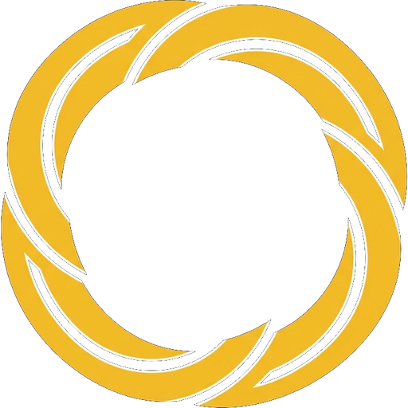
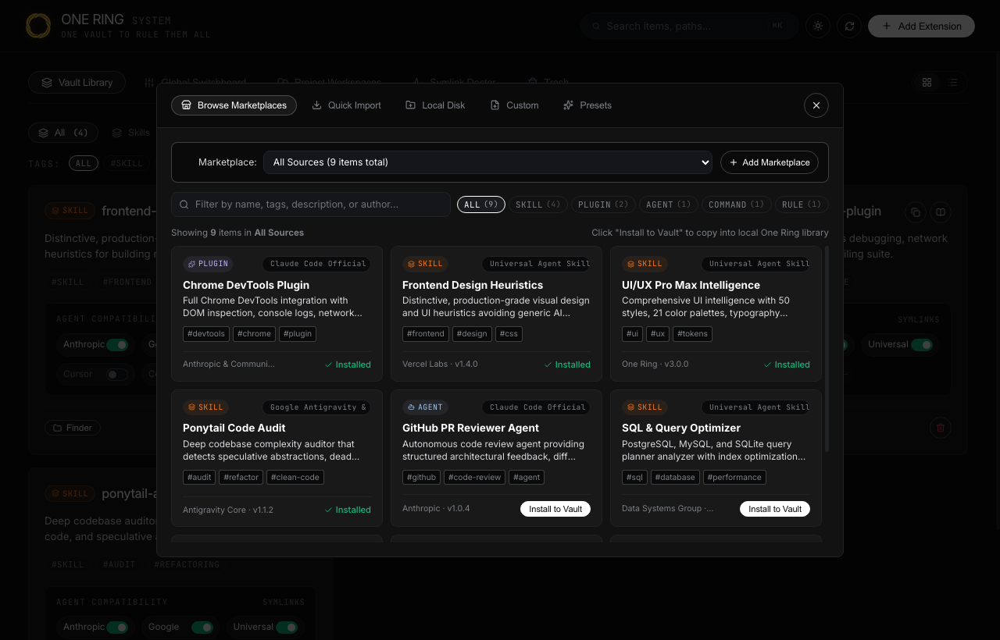
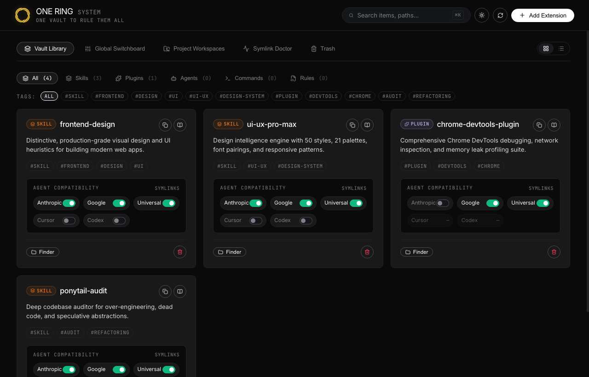
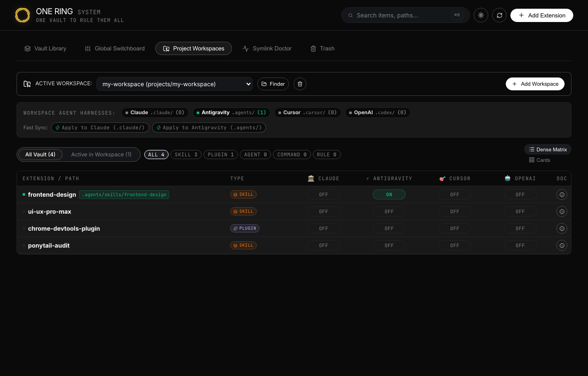
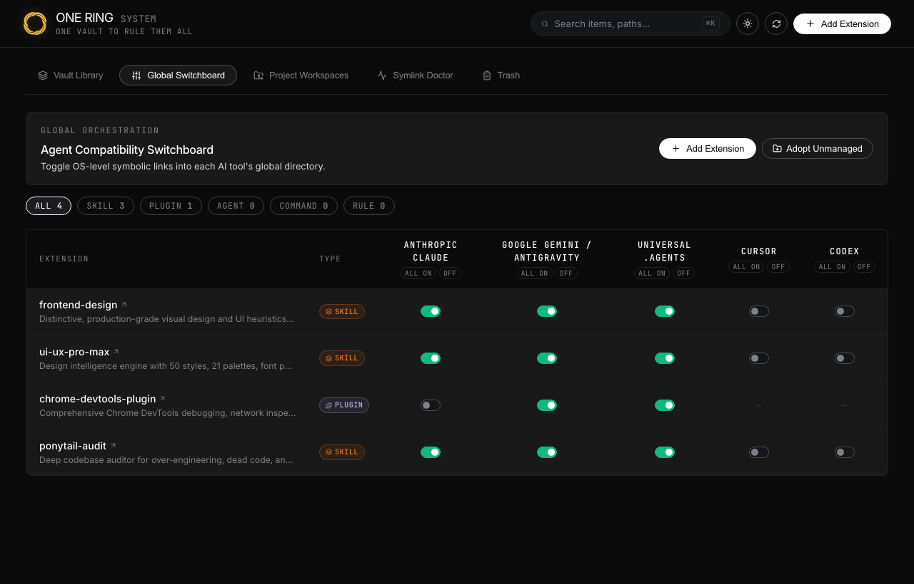
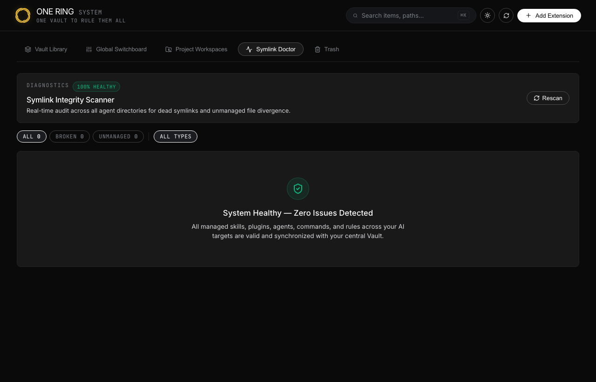
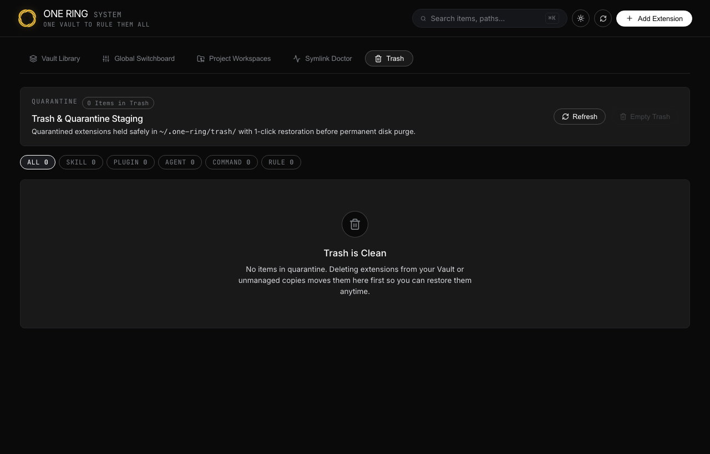
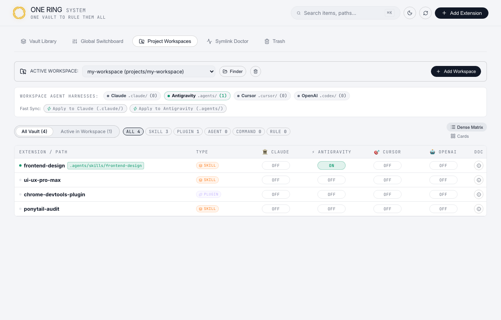

<div align="center">



# ONE RING SYSTEM

### *One Vault to rule them all*

**A unified, minimalist desktop control panel for AI agent skills, plugins, custom agents, CLI commands, and prompt rules across multiple AI coding environments.**

[](https://github.com/netsirius/one-ring/releases)
[](https://v2.tauri.app/)
[](https://www.rust-lang.org/)
[](https://react.dev/)
[](https://vitejs.dev/)
[](#-cross-platform)
[](LICENSE)

</div>

---

## ⚡ The Problem

AI coding environments and agent harnesses are multiplying fast. Every assistant uses its own isolated configuration directory:
- **Anthropic Claude Code** (`~/.claude/skills/`, `~/.claude/plugins/`, `~/.claude/commands/`, `~/.claude/rules/`)
- **Google Antigravity & Gemini CLI** (`~/.gemini/config/skills/`, `plugins/`, `rules/`, `commands/`, `agents/`)
- **Universal `.agents` Standard** (`.agents/skills/`, `.agents/rules/`, `.agents/plugins/`, `.agents/commands/`)
- **Cursor AI** (`.cursor/rules/`, `.cursor/skills/`)
- **OpenAI Codex** (`~/.codex/skills/`)

Developers end up with **scattered duplicate files**, **out-of-sync edits**, broken local project configs, and zero visibility into what extensions are active where.

---

## 💍 The Solution: One Ring

**One Ring** introduces a single source of truth. All your skills, plugins, agents, commands, and rules live once in a central isolated Vault (`~/.one-ring/vault/`) and are mapped into your global CLI targets or individual project repositories via **pure, lightning-fast OS-level symbolic links**.

- 🚀 **Zero File Duplication**: Edit once in the Vault, and changes instantly reflect across all agents.
- 🏛️ **Marketplace Browser & 1-Click Installer**: Discover and install extensions from official and community catalogs (Claude Code Official, Everything Claude Code, Google Antigravity, Agent Skills, Caveman, and custom sources).
- 🎛️ **Multi-Agent Workspace Harnesses**: Target `.claude/`, `.agents/`, `.cursor/`, or `.codex/` per workspace with 1-click **Fast Sync** and a **Dense Matrix Switchboard** with zero scroll fatigue.
- ⚡ **Native Speed & Zero Bloat**: Built with **Rust (Tauri v2)** and **React 19**. 100% in-memory native IPC with zero background daemons.
- 🛡️ **2-Stage Quarantine Trash**: Quarantines deletions in `~/.one-ring/trash/` with 1-click instant rollback before permanent disk purge.
- 🩺 **Symlink Doctor**: Real-time diagnostic engine that detects broken links, dead targets, and unmanaged file copies with 1-click auto-adoption.
- 🌓 **Engineered Obsidian & Light Mode**: Precision design language with crisp contrast in both dark and light modes.

---

## 📸 Interface & Core Views

### 1. Browse Marketplaces & 1-Click Installer
Explore curated registries (Claude Official Plugins, Everything Claude Code, Google Antigravity Plugins, Agent Skills, Caveman) or connect any custom GitHub repository:

<div align="center">
  
</div>

---

### 2. Vault Library (Single Source of Truth)
Manage your complete catalog of skills, plugins, agents, commands, and rules. Toggle global agent compatibility with interactive minimalist switches or inspect full markdown source code in the slide-over inspector:

<div align="center">
  
</div>

---

### 3. Project Workspace Multi-Agent Harnesses
Configure any local codebase with granular per-agent control. Use the **Dense Matrix Switchboard** (~36px per row) to view and toggle 20+ extensions simultaneously across `Claude Code` (`.claude/`), `Antigravity` (`.agents/`), `Cursor AI` (`.cursor/`), and `OpenAI Codex` (`.codex/`) without scrolling:

<div align="center">
  
</div>

---

### 4. Global Cross-Agent Switchboard
A matrix grid for mass-activating extensions across multiple agent CLIs (Claude, Antigravity, Universal `.agents`, Cursor, Codex) in a single click:

<div align="center">
  
</div>

---

### 5. Symlink Doctor & Diagnostics
Continuous integrity scanner that detects broken symbolic links and unmanaged copy divergence across your filesystem. Convert rogue copies into managed Vault symlinks with one click:

<div align="center">
  
</div>

---

### 6. Safe 2-Stage Quarantine Trash
Accidental deletion protection: items are safely staged in `~/.one-ring/trash/` with metadata, enabling instant 1-click restoration before permanent disk purge:

<div align="center">
  
</div>

---

### 7. Engineered Light & Dark Mode
High-contrast theme parity tailored for developer setups in bright environments:

<div align="center">
  
</div>

---

## 🏛️ System Architecture

```
                       ┌──────────────────────────────────────────────┐
                       │              THE CENTRAL VAULT               │
                       │             (~/.one-ring/vault/)             │
                       │  • skills/   • plugins/   • agents/  • rules │
                       └──────────────────────┬───────────────────────┘
                                              │
                         OS-Level Symbolic Links (Atomic & Fast)
                                              │
             ┌─────────────────────────────────┴─────────────────────────────────┐
             ▼                                                                   ▼
    GLOBAL CLI TARGETS                                                  PROJECT WORKSPACES
    ├─ Anthropic Claude (~/.claude/)                                    ├─ /repo/.claude/plugins/
    ├─ Google Gemini / AGY (~/.gemini/config/)                          ├─ /repo/.agents/skills/
    ├─ Universal Standard (~/.agents/)                                  ├─ /repo/.cursor/rules/
    ├─ Cursor AI (~/.cursor/rules/)                                     ├─ /repo/.codex/skills/
    └─ OpenAI Codex (~/.codex/)                                         └─ ...
```

### Backend IPC Architecture (`src-tauri/`)
- **`vault.rs`**: Isolates filesystem operations and manages schema manifests under `~/.one-ring/vault/`.
- **`marketplaces.rs`**: Marketplace registry, catalog indexing, URL/NPX command parsers, and isolated package installation.
- **`symlink.rs`**: Cross-platform atomic link creation, recursive parent directory generation, and symlink target validation.
- **`adapters.rs`**: Target registry mapping CLI paths and extension folder layouts for all supported agents.
- **`projects.rs`**: Persistent workspace registry stored in `~/.one-ring/projects.json` with multi-target harness sync.
- **`trash.rs`**: 2-stage quarantine and staging system backed by `~/.one-ring/trash/manifest.json`.

---

## 🎯 Supported Target Matrix

| Target Agent | Global Root | Project Local Root | Supported Extension Types |
| :--- | :--- | :--- | :--- |
| **Anthropic Claude Code** | `~/.claude/` | `<project>/.claude/` | `skill`, `plugin`, `agent`, `command`, `rule` |
| **Google Antigravity & Gemini** | `~/.gemini/config/` | `<project>/.agents/` | `skill`, `plugin`, `agent`, `command`, `rule` |
| **Universal `.agents` Standard** | `~/.agents/` | `<project>/.agents/` | `skill`, `plugin`, `agent`, `command`, `rule` |
| **Cursor AI** | `~/.cursor/rules/` | `<project>/.cursor/` | `rule`, `skill` |
| **OpenAI Codex** | `~/.codex/skills/` | `<project>/.codex/` | `skill` |

---

## 🚀 Getting Started

### Prerequisites
- **Node.js** (v18+)
- **Rust toolchain** (`cargo`, `rustc` 1.77+)
- **OS**: macOS, Linux, or Windows

### 1. Clone the repository
```bash
git clone https://github.com/netsirius/one-ring.git
cd one-ring
npm install
```

### 2. Run Desktop App in Development Mode
```bash
npm run desktop
```
*(Launches Vite dev server + Tauri native desktop window with hot module reloading)*

### 3. Run Web Preview (Browser Simulation)
```bash
npm run dev
```
Navigate to `http://localhost:5173`.

### 4. Build Native Production Release
```bash
npm run build
npx tauri build
```
The optimized native application bundles (`.app`, `.dmg`, `.deb`, `.msi`) will be generated in `src-tauri/target/release/bundle/`.

---

## ⌨️ Keyboard Shortcuts

| Shortcut | Action |
| :--- | :--- |
| **`⌘K` / `Ctrl+K`** | Focus global search bar from anywhere |
| **`Esc`** | Close slide-over inspectors and modal dialogs |

---

## 🎨 Design Principles

- **xAI / Linear Engineered Aesthetics**: Pure obsidian canvas (`#0a0a0a`), hairline 1px borders (`#212327`), and high-contrast typography.
- **Light & Dark Mode Parity**: High contrast in both dark and light modes with semantic tokens.
- **Dense Matrix Ergonomics**: Compact rows and inline controls to eliminate scroll fatigue.
- **Zero Drop Shadows**: Elevation is communicated through hairline borders and subtle surface contrast.

---

## 📄 License

This project is licensed under the [MIT License](LICENSE).
